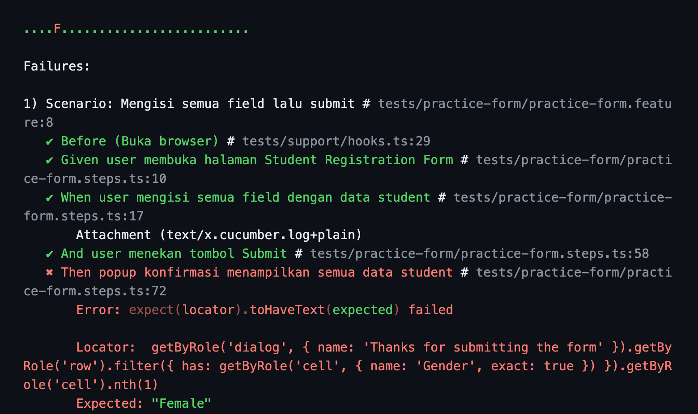
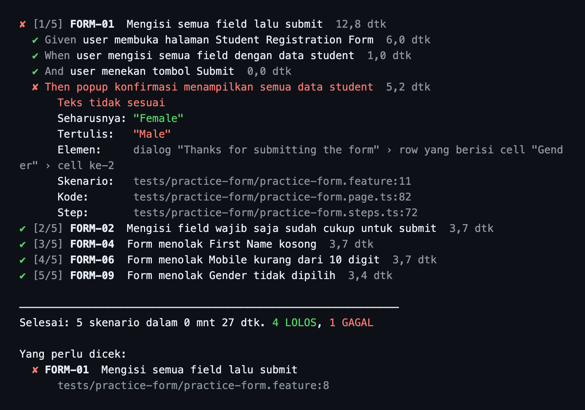
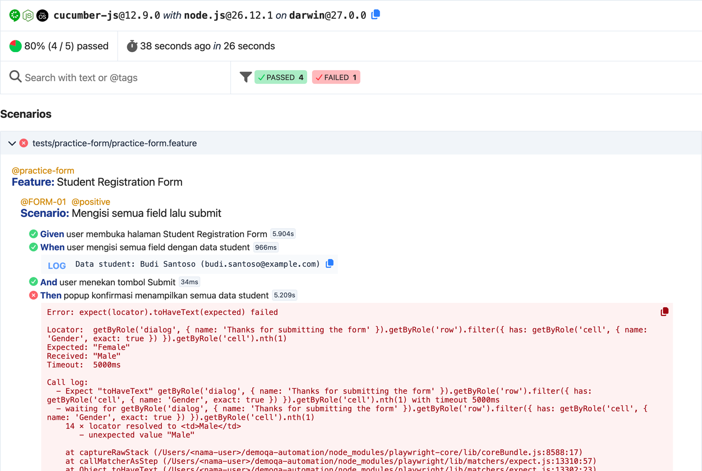
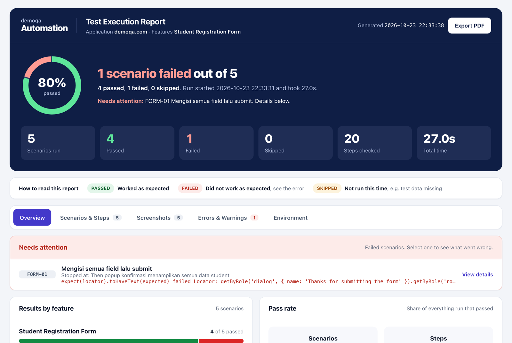
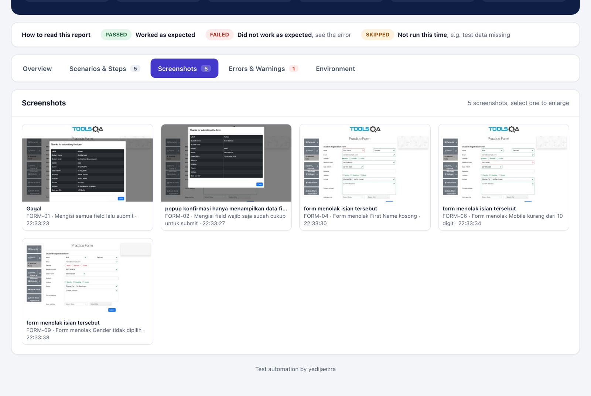

# Demoqa Automation Test

Automated tests for four pages of [demoqa.com](https://demoqa.com), written with Playwright, TypeScript, and Cucumber, using the Page Object Model with a core layer of `UIAction` and `UIAssert`.

A one-page overview of this project is live at [yedijaezra29.github.io/demoqa-automation](https://yedijaezra29.github.io/demoqa-automation/) (source in [docs/index.html](docs/index.html)): terminal output compared side by side, how to read a failed test, the HTML report, and test coverage.

The scenarios, terminal output, and failure messages are written in Indonesian. The terms you will see most:

| Term         | Meaning                      |
| ------------ | ---------------------------- |
| `Seharusnya` | Expected value               |
| `Tertulis`   | Actual value shown on page   |
| `Elemen`     | The element that was checked |
| `Skenario`   | Scenario (`.feature` line)   |
| `Kode`       | Code (page object line)      |
| `LOLOS`      | Passed                       |
| `GAGAL`      | Failed                       |
| `dtk`        | Seconds                      |

## Contents

- [What is tested](#what-is-tested)
- [Getting started](#getting-started)
- [Commands](#commands)
  - [Running tests](#running-tests)
  - [Running a Test Suite](#running-a-test-suite)
  - [Managing the report](#managing-the-report)
  - [Checking the code](#checking-the-code)
  - [Overriding settings for one run](#overriding-settings-for-one-run)
- [Terminal output](#terminal-output)
  - [Example: finding where a test failed](#example-finding-where-a-test-failed)
- [HTML report](#html-report)
- [Why I built a custom terminal output and report](#why-i-built-a-custom-terminal-output-and-report)
  - [Terminal: default vs custom](#terminal-default-vs-custom)
  - [HTML report: default vs custom](#html-report-default-vs-custom)
- [Finding the cause of a failed test](#finding-the-cause-of-a-failed-test)
- [Architecture and folder structure](#architecture-and-folder-structure)
  - [Rules for writing tests](#rules-for-writing-tests)
  - [Methods in src/core/](#methods-in-srccore)
- [Settings](#settings)
- [VS Code extension (optional)](#vs-code-extension-optional)

## What is tested

There are 28 scenarios: 11 positive (the feature works as intended) and 17 negative (the app rejects wrong input or actions).

| Page                      | Positive                                                                                      | Negative                                                                                                                      |
| ------------------------- | --------------------------------------------------------------------------------------------- | ----------------------------------------------------------------------------------------------------------------------------- |
| Web Tables                | Adds 5 users at once and checks each one in the table, searches for a user, deletes a user    | Search with no results, the Add form rejects an email without @, an empty First Name, letters in Age or Salary, an empty form |
| Droppable                 | Drag Me is accepted on the Simple tab, Acceptable is accepted on the Accept tab               | A box dropped outside the target, Not Acceptable rejected on the Accept tab                                                   |
| Resizable                 | Size 400 × 200, the 150 × 150 minimum, and the 500 × 300 maximum                              | Dragged past the maximum or below the minimum, the box stops at the limit                                                     |
| Student Registration Form | All fields filled, only required fields filled, a Mobile number over 10 digits cut down to 10 | Empty First Name or Last Name, Mobile under 10 digits or containing letters, email without @, no Gender selected, empty form  |

## Getting started

You need Node.js 20.12 or newer. Every command below is the same on macOS, Linux, and Windows (Command Prompt or PowerShell) and runs from a terminal. The VS Code extension is optional.

Install dependencies once:

```bash
npm install
npx playwright install chromium
```

Run every test:

```bash
npm test
```

When the run finishes, the HTML report opens in your browser. The file is `reports/test-report.html`.

To run one page only:

```bash
npm run test:webtables
npm run test:droppable
npm run test:resizable
npm run test:practice-form
```

To watch the browser while tests run, use `npm run test:headed`.

## Commands

Run every command from the project root.

### Running tests

| Command                       | What it does                                        |
| ----------------------------- | --------------------------------------------------- |
| `npm test`                    | Run every test, then build and open the HTML report |
| `npm run test:webtables`      | Run Web Tables tests only                           |
| `npm run test:droppable`      | Run Droppable tests only                            |
| `npm run test:resizable`      | Run Resizable tests only                            |
| `npm run test:practice-form`  | Run Student Registration Form tests only            |
| `npm test -- --tags @FORM-01` | Run tests by tag                                    |
| `npm run test:raw`            | Run every test without building a report (faster)   |
| `npm run test:headed`         | Run every test with the browser visible             |

Every scenario has a TC number (`@WEBTABLES-01` to `@WEBTABLES-09`, `@DROPPABLE-01` to `04`, `@RESIZABLE-01` to `05`, `@FORM-01` to `10`) and a `@positive` or `@negative` tag. A few examples:

```bash
npm test -- --tags @positive
npm test -- --tags @negative
npm test -- --tags "@webtables and @negative"
npm test -- --tags "@WEBTABLES-01 or @FORM-01"
```

### Running a Test Suite

| Command                              | What it does                                  |
| ------------------------------------ | --------------------------------------------- |
| `npm run suite`                      | List the Test Suites                          |
| `npm run suite -- Regresi`           | Run the Regresi suite, then build the report  |
| `npm run suite -- Smoke --no-report` | Run the Smoke suite without building a report |

Available suites: Regresi (regression, every scenario), Smoke (one main scenario per page), Positif (positive), and Negatif (negative). Scenarios run in the order listed in the suite.

The suites live in `test-suites.json`. To add a suite without VS Code, copy one suite in that file, change its `name`, and edit its `entries`. Entries with `checked` set to `false` are skipped.

### Managing the report

| Command                | What it does                                  |
| ---------------------- | --------------------------------------------- |
| `npm run report`       | Rebuild the report from the last test run     |
| `npm run report:open`  | Open the last report in the browser           |
| `npm run report:clean` | Delete the `reports/` folder and its contents |

### Checking the code

| Command                | What it does                                         |
| ---------------------- | ---------------------------------------------------- |
| `npm run check`        | TypeScript type check, format check, and unit tests  |
| `npm run typecheck`    | TypeScript type check only                           |
| `npm run format`       | Format every file                                    |
| `npm run format:check` | Check formatting without changing files              |
| `npm run test:unit`    | Run the unit tests for the terminal failure messages |

### Overriding settings for one run

Any setting from `.env` can be overridden for a single run. On macOS and Linux, put it in front of the command:

```bash
HEADLESS=false npm run test:droppable
BROWSER=firefox npm test
PROGRESS=detail npm test
```

In Windows PowerShell:

```powershell
$env:HEADLESS="false"; npm run test:droppable
```

In Windows Command Prompt:

```bat
set HEADLESS=false&& npm run test:droppable
```

In PowerShell and Command Prompt the value stays set until you close that terminal window. The one method that works the same everywhere is editing `.env` (a copy of `.env.example`).

`PROGRESS=detail` prints the steps of every test case in the terminal, including the ones that pass.

## Terminal output

I (yedijaezra) built the terminal output for this project myself, and I have used it on several projects at work. It replaces Cucumber's default output. Each test case takes one line: `▶ [2/28] FORM-02 ...` while it runs, then the result, for example `✔ [2/28] FORM-02  Mengisi field wajib saja sudah cukup untuk submit  3,1 dtk`.

For a failed test case, the terminal shows every step (✔ passed, ✘ failed, ○ not run), the reason in plain words, the expected value next to what the page shows, and three locations you can open directly (cmd+click or ctrl+click in the VS Code terminal):

- **Skenario**: the line in the `.feature` file
- **Kode**: the line of code that failed, usually in the page object
- **Step**: the step definition that ran it

### Example: finding where a test failed

To see how it works, make one test fail on purpose:

1. Open `test-data/practice-form.json`. In the `confirmation` section, change `"Gender": "Male"` to `"Gender": "Female"`.
2. Run:

   ```bash
   npm run test:raw -- --tags @FORM-01
   ```

3. The terminal shows:

   ```
   ✘ [1/1] FORM-01  Mengisi semua field lalu submit  9,5 dtk
     ✔ Given user membuka halaman Student Registration Form  2,9 dtk
     ✔ When user mengisi semua field dengan data student  1,1 dtk
     ✔ And user menekan tombol Submit  0,0 dtk
     ✘ Then popup konfirmasi menampilkan semua data student  5,2 dtk
         Teks tidak sesuai
         Seharusnya: "Female"
         Tertulis:   "Male"
         Elemen:     Nilai Gender di popup konfirmasi
         Skenario:   features/practice-form/practice-form.feature:11
         Kode:       features/practice-form/practice-form.page.ts:94
         Step:       features/practice-form/practice-form.steps.ts:72

   ────────────────────────────────────────────────────────────
   Selesai: 1 skenario dalam 0 mnt 9 dtk. 1 GAGAL

   Yang perlu dicek:
     ✘ FORM-01  Mengisi semua field lalu submit
         features/practice-form/practice-form.feature:8
   ```

4. How to read it:
   - The first three steps passed. The step `✘ Then popup konfirmasi menampilkan semua data student` (the confirmation popup shows all student data) is the one that failed.
   - Below it is the reason: `Teks tidak sesuai` (text does not match). The test expected Gender "Female", but the popup says "Male". `Elemen` names the part of the page that was checked, the Gender value in the popup. The name comes from the last argument of the `UIAssert` call in the page object.
   - Hold cmd (macOS) or ctrl (Windows and Linux) and click a location to open the file at that exact line:
     - `Skenario` opens the failed step in the `.feature` file.
     - `Kode` opens the check that failed in the page object. Lines inside `src/core/` are skipped, so it always lands in the page object.
     - `Step` opens the step definition that called that check.
   - In this example the app is right and the expected data is wrong, so the fix goes in `test-data/practice-form.json`.

5. Change `"Gender": "Female"` back to `"Gender": "Male"`.

Clickable locations work in the VS Code terminal. Other terminals vary, so if a location is not clickable, open the file and go to that line by hand.

Every run ends with a summary and a list of test cases to check. To see every step while tests run, use `PROGRESS=detail`.

## HTML report

I also built the HTML report myself, and use it on several projects at work. It replaces Cucumber's default report. `npm test` writes `reports/test-report.html` and opens it in the browser. The report is a single file, so you can double-click it or send it to someone without a server. It has five tabs:

- **Overview**: pass rate, results per page, failed test cases, and the duration of each test case.
- **Scenarios & Steps**: every test case and its steps with status, duration, logs, error messages, and screenshots. Searchable and filterable by status.
- **Screenshots**: every screenshot in one gallery. By default one is taken at each result check (Then/And steps) and whenever a test case fails.
- **Errors & Warnings**: all failures in one list, with stack traces that use paths relative to the project folder.
- **Environment**: the tested URL, browser, viewport, timeout, tags, and the Node.js, Cucumber, and Playwright versions.

The **Export PDF** button saves the report as a PDF. To rebuild the report from the last run without running the tests again, use `npm run report`.

## Why I built a custom terminal output and report

Cucumber's default output and report are hard to read, especially when a test fails, so I built my own. All images below come from one run: five Student Registration Form test cases, with FORM-01 failing on purpose (the expected Gender in the test data changed to "Female").

These images were taken before the project moved to the `UIAction` and `UIAssert` core. Since then, file paths start with `features/`, the `Elemen` line holds an element name such as `Nilai Gender di popup konfirmasi`, and the failure in Cucumber's default output is a single line from `UIAssert` followed by a stack trace. The latest output is in [Example: finding where a test failed](#example-finding-where-a-test-failed).

### Terminal: default vs custom

<table>
  <tr>
    <th width="50%">Cucumber default</th>
    <th width="50%">Custom</th>
  </tr>
  <tr>
    <td></td>
    <td></td>
  </tr>
  <tr>
    <td valign="top">
      <ul>
        <li>While tests run you only see dots, with no test case names.</li>
        <li>The failure reason is Playwright's long technical message, followed by a call log and a stack trace from <code>node_modules</code>.</li>
      </ul>
    </td>
    <td valign="top">
      <ul>
        <li>One line per test case, with its TC number and duration.</li>
        <li>A failed test case lists all of its steps, a short reason, and the expected value next to the actual one.</li>
        <li>Three clickable locations, then a summary and a list of tests to check.</li>
      </ul>
    </td>
  </tr>
</table>

### HTML report: default vs custom

<table>
  <tr>
    <th width="50%">Cucumber default</th>
    <th width="50%">Custom</th>
  </tr>
  <tr>
    <td></td>
    <td></td>
  </tr>
  <tr>
    <td valign="top">
      <ul>
        <li>A list of scenarios and steps with their status, plus a passed or failed filter.</li>
        <li>The technical error is printed as-is under the failed step.</li>
        <li>The header shows the laptop's operating system.</li>
      </ul>
    </td>
    <td valign="top">
      <ul>
        <li>The first page shows the pass rate, the count per status, and the tests to check.</li>
        <li>Every error in one list, and an Export PDF button.</li>
        <li>A PM or client can read it without opening the code.</li>
      </ul>
    </td>
  </tr>
</table>

The custom report also has a gallery of the screenshots from every check, including failures. The default report has nothing like it.



## Finding the cause of a failed test

I wrote the failure messages so that anyone who uses or maintains this suite, not only me, knows which file to open. Every failure points to three locations, one per layer of the code:

| Location   | File                                    | What it holds                    |
| ---------- | --------------------------------------- | -------------------------------- |
| `Skenario` | `features/<feature>/<feature>.feature`  | Test steps in plain language     |
| `Step`     | `features/<feature>/<feature>.steps.ts` | The link between steps and pages |
| `Kode`     | `features/<feature>/<feature>.page.ts`  | Page actions and checks          |

The reason on the first line usually tells you where to look:

| Failure reason                                                      | Meaning                                            | What to check                                                                                                  |
| ------------------------------------------------------------------- | -------------------------------------------------- | -------------------------------------------------------------------------------------------------------------- |
| `Teks tidak sesuai`                                                 | Text does not match                                | The expected value in `test-data/<feature>.json`. If the data is right, the app probably changed or has a bug. |
| `Jumlah elemen tidak sesuai`                                        | Element count does not match                       | Test data or app behavior, such as the number of rows in a table.                                              |
| `Elemen tidak terlihat di layar, elemen tidak ditemukan di halaman` | Element not visible, element not found on the page | The selector in `features/<feature>/<feature>.locators.ts`. Usually the page layout changed.                   |
| `Elemen tidak muncul setelah ... detik`                             | Element did not appear after ... seconds           | The selector, or a slow page.                                                                                  |
| `Tidak bisa mengklik dalam ... detik`                               | Could not click within ... seconds                 | The selector, or an element covered by something else, such as a popup.                                        |
| `Step ini belum punya step definition`                              | This step has no step definition yet               | A new step in the `.feature` file with no match in the steps file.                                             |
| `Halaman tidak bisa dibuka (...)`                                   | The page could not be opened                       | The internet connection, or demoqa itself being down.                                                          |

The full stack trace is still in the HTML report (Errors & Warnings tab), with paths relative to the project folder, so it matches the files in the repo.

## Architecture and folder structure

Each layer only calls the layer below it:

```text
Feature (.feature)
  └── Step Definition (.steps.ts)    thin translation from a sentence to a page method
        └── Page Object (.page.ts)    actions and checks for one page
              └── Locator (.locators.ts)    every selector for that page
                    └── Core (src/core/)    UIAction for actions, UIAssert for checks
                          └── Playwright → Browser
```

```text
features/
  web-tables/
    web-tables.feature      scenarios in plain language
    web-tables.steps.ts     step definitions, connecting scenarios to the page
    web-tables.page.ts      page actions and result checks (verify)
    web-tables.locators.ts  element selectors
  droppable/                same layout
  resizable/                same layout
  practice-form/            same layout
components/                 UI modules shared by more than one page
src/
  core/
    UIAction.ts             every browser action: click, fill, select, upload, drag, wait
    UIAssert.ts             every check, retried until it passes or times out
  config/
    env.ts                  settings from .env
    validation.ts           demoqa's validation red
  utils/
    browser.ts              BrowserManager: opens and closes a browser per scenario
support/
  hooks.ts                  Before/After per scenario: browser, screenshots, video
  world.ts                  TestWorld: the page and state of one scenario
test-data/                  test data per page as JSON, plus a photo for upload
reports/                    run results, HTML report, screenshots, and video
tools/                      HTML report, suite command, and VS Code extension
docs/                       project overview page and README images
test-suites.json            Test Suite list
```

All files for one page live in one folder. Its test data lives in `test-data/` under the same name, for example `test-data/web-tables.json`.

Feature files only hold steps in plain language. Input values and expected results are in JSON, and the checks are the `verify...` methods in the page object. To add or change data, edit the JSON file.

### Rules for writing tests

- Step definitions only call page object methods. No selectors, checks, or browser handling in step files.
- Every selector lives in the `.locators.ts` file of its page.
- Every browser action goes through `UIAction` and every check through `UIAssert`. Page objects never call Playwright or `expect` directly.
- `UIAction` and `UIAssert` methods are `static async`, so every call needs `await`. Without it, the step finishes before the action runs and the error shows up in a different step.
- Waiting is always based on a condition (an element appears, disappears, or its text changes). No `waitForTimeout` or fixed sleeps.
- Page navigation lives in the page object, the browser opens and closes in `BrowserManager`, and the scenario lifecycle lives in `support/hooks.ts`.
- Selector priority: `data-testid`, role and visible name, a stable `id`, a stable attribute combination, then XPath only when nothing else works.
- Tests follow what the demoqa pages actually do. Selectors, text, and URLs are never invented.
- Fix problems in the narrowest layer responsible: a wrong selector in the locators file, wrong data in `test-data/`.

### Methods in `src/core/`

`UIAction`:

| Group         | Methods                                                                 |
| ------------- | ----------------------------------------------------------------------- |
| Navigation    | `goto`                                                                  |
| Mouse         | `click`, `doubleClick`, `hover`, `dragTo`, `dragBy`                     |
| Text          | `inputText`, `clearText`, `fill`, `clear`, `type`, `press`              |
| Form          | `check`, `uncheck`, `selectOption`, `uploadFile`                        |
| Focus, scroll | `focus`, `blur`, `scrollIntoView`                                       |
| Wait          | `waitForAttached`, `waitForVisible`, `waitForHidden`, `waitForDetached` |

`UIAssert` retries a check every 100 ms until it passes or 5 seconds run out. If it still fails, the message says what should have held and what the last attempt saw, and the terminal turns that into a plain-language reason.

| Group        | Methods                                                                                               |
| ------------ | ----------------------------------------------------------------------------------------------------- |
| Visibility   | `visible`, `hidden`                                                                                   |
| DOM presence | `attached`, `detached`, `count`                                                                       |
| Content      | `text`, `texts`, `containsText`, `notContainsText`, `value`, `attribute`, `className`, `notClassName` |
| Appearance   | `css`, `size`                                                                                         |
| State        | `enabled`, `disabled`, `checked`, `unchecked`                                                         |
| Navigation   | `urlContains`                                                                                         |

## Settings

Settings are read from a `.env` file. Every setting has a default, so tests run without that file. To change one, copy `.env.example` to `.env` and edit the value:

| Setting               | Default              | What it does                                                                                         |
| --------------------- | -------------------- | ---------------------------------------------------------------------------------------------------- |
| `BASE_URL`            | `https://demoqa.com` | The site under test                                                                                  |
| `BROWSER`             | `chromium`           | Also accepts `firefox` or `webkit` (install them first with `npx playwright install firefox webkit`) |
| `HEADLESS`            | `true`               | `false` to show the browser                                                                          |
| `DEFAULT_TIMEOUT`     | `15000`              | How long to wait for an element, in milliseconds                                                     |
| `STEP_SCREENSHOT`     | `expected`           | `expected`: a screenshot at every check, `true`: every step, `false`: only on failure                |
| `REPORT_OPEN`         | `true`               | `false` to stop the report from opening automatically                                                |
| `IGNORE_HTTPS_ERRORS` | `false`              | `true` for sites with an invalid HTTPS certificate                                                   |
| `RECORD_VIDEO`        | `false`              | `true` to record a video of every scenario to `reports/videos/`                                      |

## VS Code extension (optional)

Everything above runs from a terminal. The extension is an extra for people who prefer clicking: run tests from the VS Code Testing panel, see the status of every test case, and manage Test Suites (create, check, drag to reorder). Suites made in the extension are saved to the same `test-suites.json`, so they also run from the terminal. To install:

```bash
code --install-extension tools/vscode-extension/demoqa-tests.vsix
```

The full guide is in [tools/vscode-extension/README.md](tools/vscode-extension/README.md).
